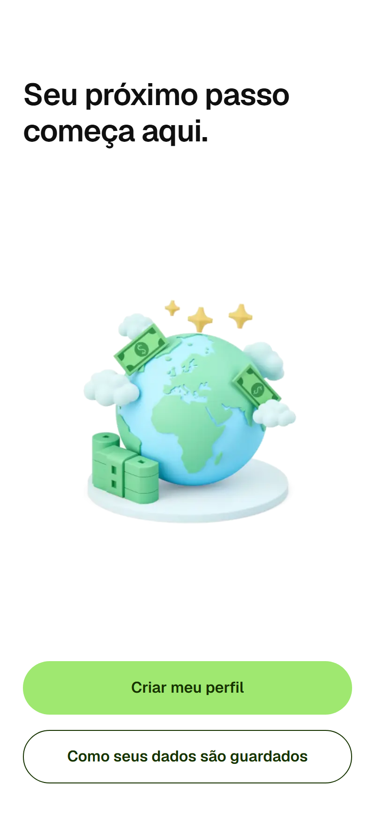
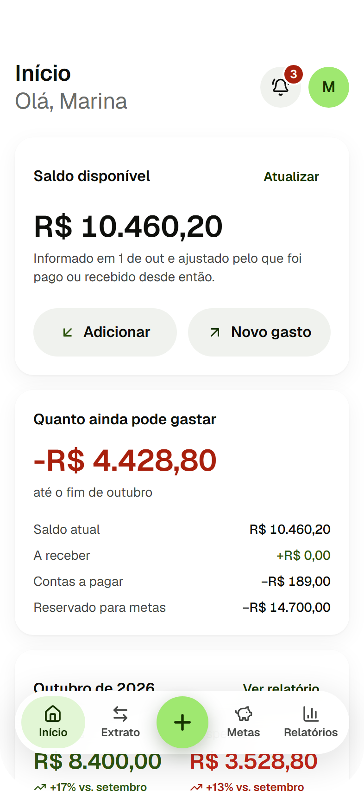
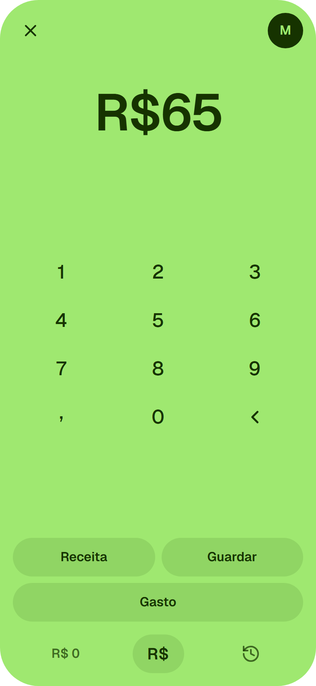
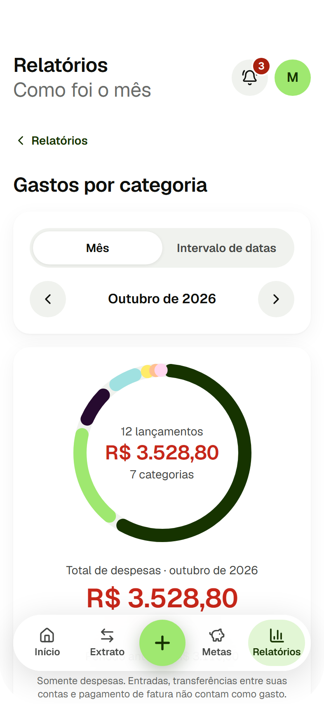
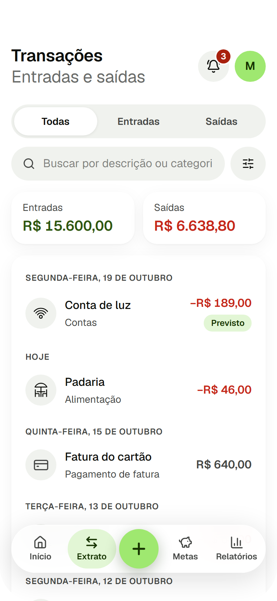
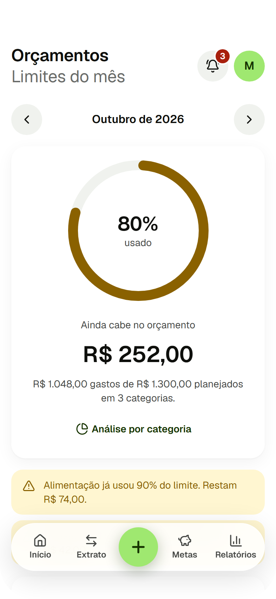
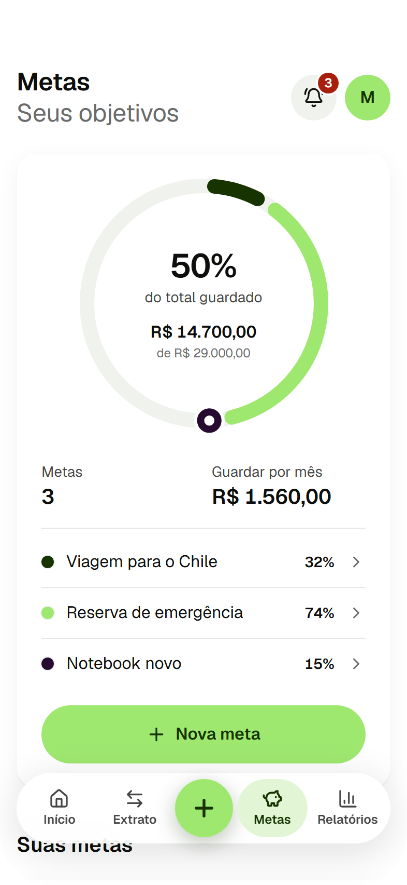
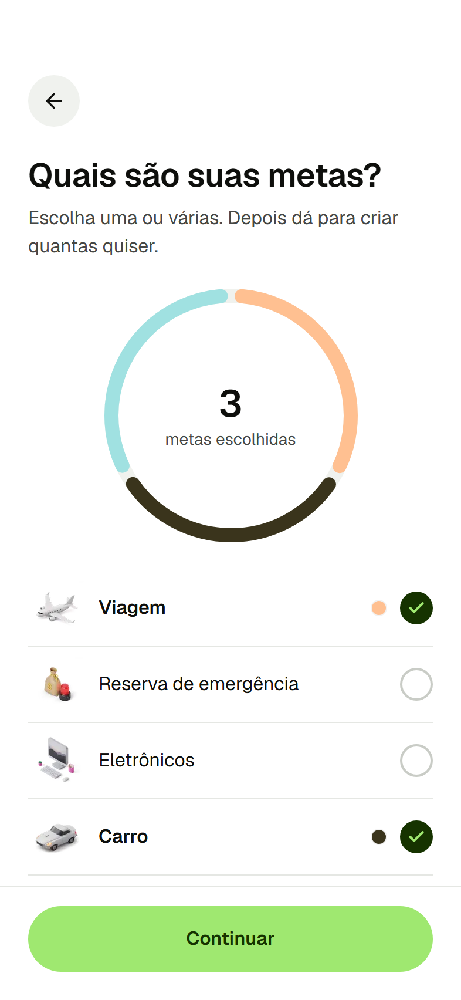
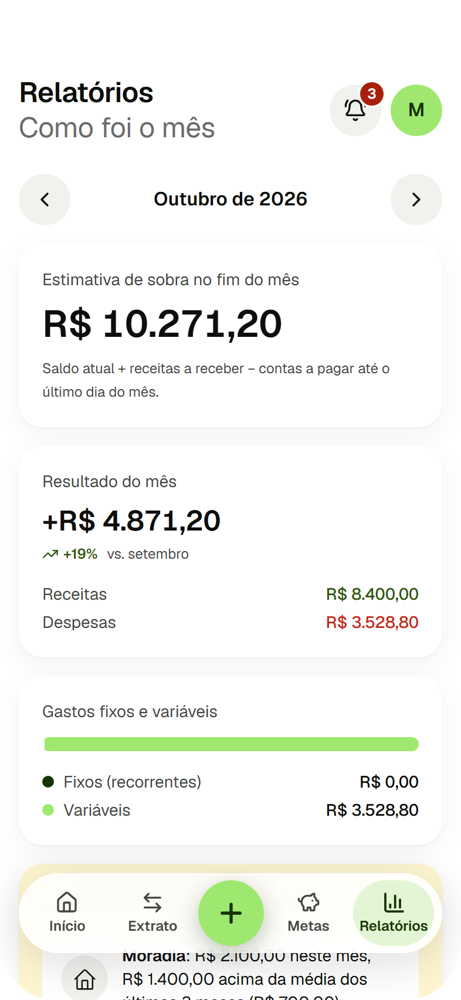
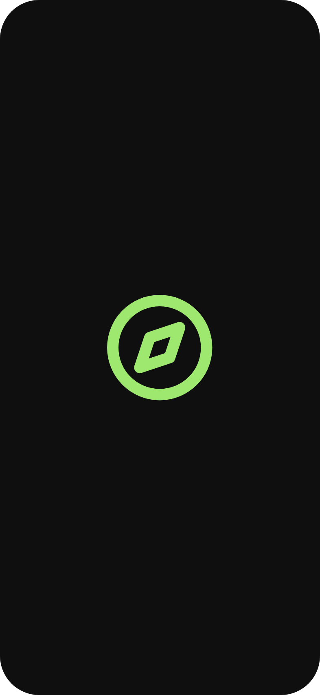

<p align="center">
  <picture>
    <source media="(prefers-color-scheme: dark)" srcset="public/brand/logo-dark-192.png">
    
  </picture>
</p>

<h1 align="center">Prumo</h1>

<p align="center">
  <strong>Finanças pessoais para entender, planejar e melhorar a relação com o dinheiro.</strong><br>
  Registre em segundos, veja para onde vai cada real e chegue às suas metas — sem conectar banco e sem movimentar dinheiro.
</p>

<p align="center">
  <a href="https://prumo-zeta-liart.vercel.app"><strong>Abrir o app</strong></a>
  ·
  <a href="https://bragahauser-byte.github.io/prumo/">Versão no GitHub Pages</a>
  ·
  <a href="docs/PRODUCT_SPEC.md">Produto</a>
  ·
  <a href="docs/DESIGN_SYSTEM.md">Design system</a>
</p>

<p align="center">
  
  
  
  
</p>

## Por que o Prumo

O Prumo não movimenta dinheiro. Ele organiza o que você registra para responder, com clareza, três perguntas:

- **Como está minha vida financeira agora?**
- **Quanto ainda posso gastar este mês?**
- **O que vem pela frente?**

Assim dá para antecipar problemas antes que aconteçam: a conta que vence amanhã, a categoria que está estourando, a meta que ficou para trás.

## O que o app faz

| | Funcionalidade | Resumo |
|---|---|---|
| 🏠 | **Início** | Saldo disponível (atualizado em 1 a 2 toques, geral ou por conta), quanto ainda pode gastar no mês, entradas e saídas com comparação ao mês anterior, investimentos, próximos vencimentos e atalhos. O olho no topo oculta os valores. |
| ✨ | **Assistente de IA** | Responde em português usando os seus registros por meio de ferramentas determinísticas (gastos por período, categoria e banco, saldo e previsão, comparação de períodos, recorrências, simulação de meta, investimentos, conversão de moedas). Cria meta, ajusta orçamento ou registra gasto só depois da sua confirmação. |
| 🏦 | **Bancos e moedas** | Contas com logo do banco, saldo por conta e em outras moedas (USD, EUR…), com conversão para a moeda-base pela cotação de referência (data visível) ou por taxa manual. Extrato e relatórios agrupados por banco. |
| 📈 | **Investimentos** | Cadastro de aplicações (tipo, instituição, valor aplicado, valor atual opcional e data), distribuição por tipo e um guia neutro dos 8 tipos mais comuns. |
| 💸 | **Registro de entradas e saídas** | Valor primeiro, num teclado em tela cheia; depois categoria sugerida pela descrição, data, status e repetição. Busca, filtros, edição e exclusão. |
| 📊 | **Gastos por categoria** | Total do período somado a partir dos lançamentos, participação de cada categoria, gráfico de distribuição, ordem por maior ou menor gasto, comparação com o período anterior e filtros por mês ou intervalo de datas. |
| 🎯 | **Orçamento mensal** | Limite por categoria com gasto, restante, porcentagem usada e estado (normal, próximo do limite, atingido ou ultrapassado). Alertas configuráveis; um gasto acima do limite é registrado e o excedente aparece. |
| 🔁 | **Movimentações internas** | Transferência entre contas próprias e pagamento de fatura não contam como gasto nem mudam o saldo — as compras do cartão já foram registradas uma a uma. |
| 📅 | **Agenda** | Contas a pagar e a receber: atrasadas, próximos 7 dias e adiante; recorrências semanais, mensais, anuais ou personalizadas. |
| 🐷 | **Metas** | Doze tipos com ilustração 3D, várias metas de uma vez, anel dividido entre elas, barra com o ritmo esperado para hoje e uma comemoração quando a meta é atingida. |
| 🔔 | **Notificações** | Alertas importantes, lembretes no horário que você escolher (desligados por padrão), até três insights e confirmações discretas na tela. A central fica em Ajustes. |
| 📈 | **Relatórios** | Evolução de seis meses, categorias que mais pesam, aumentos fora do comum e estimativa de sobra no fim do mês. |

Regras de cálculo em [docs/PRODUCT_SPEC.md](docs/PRODUCT_SPEC.md).

## Telas

<p align="center">
  
  
  
  
</p>
<p align="center">
  
  
</p>

## Design

- **Paleta:** verde vivo (`#9FE870`) e verde floresta (`#163300`) como cores principais; verde para o que entra e a cor do texto para o que sai (sem vermelho); laranja (`--color-highlight`) só para navegação ativa e assistente; secundárias para categorias e gráficos. Tokens em `src/app/globals.css`.
- **Tipografia:** escala fixa de 12, 14, 16, 20, 24, 28 e 32 px.
- **Logo:** bússola com versões clara e escura, escolhidas pelo tema do sistema (ícone da aba, ícone do app e no próprio README).
- **Ilustrações** isométricas 3D (bnbicons.com) em `public/illustrations` e `public/goal-icons`.
- **Celular primeiro:** cabeçalho a 64 px do topo, navegação flutuante a 40 px da borda inferior, alvos de toque de pelo menos 44 px.

Mais em [docs/DESIGN_SYSTEM.md](docs/DESIGN_SYSTEM.md).

## Tecnologias

| Tecnologia | Papel |
|---|---|
| **TypeScript + React + Next.js** | Interface e aplicação web (Next.js 16 com App Router, React 19). |
| **CSS + Tailwind CSS** | Estilização e responsividade, com tokens de cor e tipografia (Tailwind CSS 4). |
| **Supabase + PostgreSQL** | Login e sincronização opcionais, com regras de acesso por usuário (RLS) nas tabelas. |

Também: Zod (validação), Lucide (ícones), Vitest e Playwright (testes).

## Como rodar

Requer Node.js 20+.

```bash
npm install
npm run dev
```

Abra http://localhost:3000. Sem configuração, o app funciona no **modo local**: tudo fica salvo no `localStorage` deste navegador, sem dados de exemplo e sem nada sair do dispositivo.

### Assistente de IA (opcional)

O chat chama uma rota do servidor (`src/app/api/assistant/route.ts`) que faz proxy para a API da Anthropic; a chave nunca vai para o navegador. Copie `.env.example` para `.env.local` e preencha:

| Variável | Obrigatória | Padrão |
|---|---|---|
| `ANTHROPIC_API_KEY` | sim | — |
| `ANTHROPIC_MODEL` | não | `claude-sonnet-5-5` |
| `ANTHROPIC_EFFORT` | não | `low` |

As ferramentas rodam no navegador, sobre os dados locais, e só o resultado de cada consulta vai para o modelo. O histórico de conversas fica no `localStorage`. Sem a chave (ou no GitHub Pages, que é estático), o chat mostra um aviso.

### Sincronização com Supabase (opcional)

Copie `.env.example` para `.env.local`, preencha a URL e a chave publishable do projeto e aplique as migrations de `supabase/migrations/`. Com as variáveis presentes, as rotas exigem login e os dados ficam na sua conta, protegidos por RLS.

```bash
supabase start
supabase db reset
supabase test db
```

## Publicação

- **GitHub Pages:** cada push na `main` roda `.github/workflows/pages.yml` — testes, build estático (`DEPLOY_TARGET=pages`, servido em `/prumo`) e publicação. Usa o modo local.
- **Vercel:** https://prumo-zeta-liart.vercel.app — publica a cada push na `main` com o build padrão do Next (modo local, sem variáveis). Com as variáveis do Supabase no projeto, login e sincronização passam a funcionar; com `ANTHROPIC_API_KEY`, o assistente de IA.

## Scripts

```bash
npm run dev        # servidor de desenvolvimento
npm run lint       # ESLint
npm test           # testes unitários (Vitest)
npm run test:e2e   # testes ponta a ponta (Playwright)
npm run build      # build de produção
```

## Estrutura

- `src/app` — rotas: `overview`, `transactions`, `add`, `bills`, `budgets`, `goals`, `reports` (e `reports/categories`), `settings`, onboarding e autenticação
- `src/components` — telas, fluxo de registro e kit de interface (`ui/`)
- `src/domain` — regras puras: dinheiro, recorrência, categorias, planejamento, análise por categoria e notificações
- `src/lib` — repositórios (local e Supabase), formatação e datas
- `supabase` — migrations e testes de RLS
- `docs` — produto, design, arquitetura, modelo de dados, segurança, testes, deploy e prints

Veja também [arquitetura](docs/ARCHITECTURE.md), [modelo de dados](docs/DATA_MODEL.md), [segurança](docs/SECURITY.md), [plano de testes](docs/TEST_PLAN.md) e [deploy](docs/DEPLOYMENT.md).
